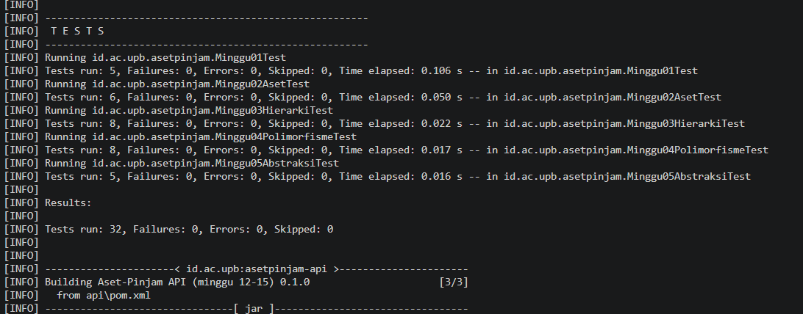
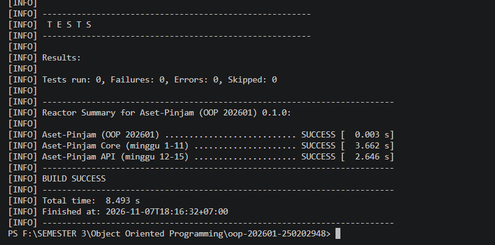

# Catatan Praktikum Minggu 05 –  Abstraction

## Yang saya kerjakan
Pengerjaan minggu ini berfokus pada penerapan abstraction dengan mengubah class Aset menjadi abstract class. Saya juga melengkapi aturan peminjaman serta membuat DendaFlat dan DendaProgresif untuk menangani perhitungan denda keterlambatan.

## Keputusan desain

Saat mengerjakan bagian ini, saya mempertahankan atribut umum aset pada class induk supaya tidak perlu ditulis ulang pada setiap subclass. Sementara itu, perhitungan denda tetap ditempatkan pada masing-masing jenis aset karena nilai dendanya tidak sama.

Untuk aturan peminjaman, saya menggunakan dua kondisi sebagai pemeriksaan. Aset harus memiliki status tersedia dan tidak boleh berada dalam kondisi rusak berat.

Saya juga memisahkan cara menghitung denda menjadi dua class. DendaFlat menggunakan nilai denda dasar dari aset, sedangkan DendaProgresif menambahkan biaya berdasarkan lama keterlambatan. Rumus progresif yang dipilih adalah denda flat ditambah hasil perkalian denda flat dengan jumlah hari keterlambatan, kemudian dibagi 10.

## Kendala

Ada beberapa bagian yang sempat membuat program belum bisa dikompilasi. Kesalahan pertama berasal dari penempatan kurung kurawal yang belum sesuai. Saya memeriksa kembali susunan kode pada file yang bermasalah dan memperbaiki pasangan kurungnya.

Masalah lain muncul setelah method hitungDenda() diubah menjadi abstract. Pemanggilan method tersebut melalui super tidak bisa digunakan seperti sebelumnya karena method induk sudah tidak memiliki implementasi. Saya kemudian menyesuaikan bagian perhitungan pada class turunannya.

Saya juga menemukan bahwa beberapa class belum mengenali nama class yang digunakan karena import belum ditambahkan. Setelah bagian tersebut diperbaiki, saya melanjutkan pemeriksaan program.

## Penggunaan AI

- **Alat yang dipakai:** Claude.
- **Bagian yang dibantu AI:** Aset.java, DendaFlat.java, dan DendaProgresif.java.

**Prompt utama:**

1. Bantu saya menyesuaikan class Aset yang sebelumnya sudah digunakan pada materi inheritance dan polymorphism agar bisa menerapkan abstraction sesuai instruksi terbaru.
2. Saya ingin memisahkan aturan perhitungan denda dari class aset. Jelaskan bagaimana DendaFlat dan DendaProgresif seharusnya bekerja dalam project ini.
3. Periksa perubahan kode yang sudah saya lakukan. Telusuri penyebab error yang muncul dan jelaskan bagian mana yang harus diperbaiki tanpa mengubah fungsi dari materi sebelumnya.

- **Yang saya ubah atau tidak ikuti dari saran AI, dan alasannya:** Saya menyesuaikan kode dengan struktur project yang sudah ada. Untuk perhitungan denda progresif, saya memilih rumus sendiri menggunakan pembagi 10 agar kenaikan dendanya lebih cepat.

- **Satu hal yang saya pahami lebih baik sekarang:** Saya lebih memahami pembagian tanggung jawab antara abstract class, class turunan, dan interface dalam Java.

## Dokumentasi

Bagian ini berisi bukti pengerjaan dan hasil pengujian program Minggu 5.

