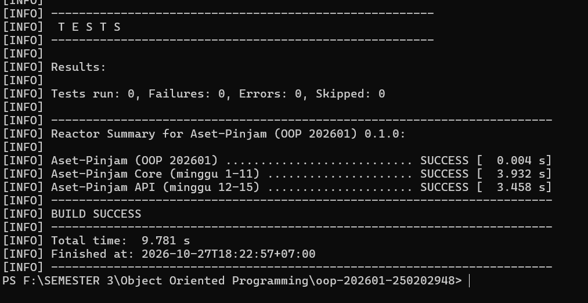

# Catatan Minggu 02: Struktur OOP: Class, Object, Encapsulation

## Yang saya kerjakan

Pada minggu kedua, saya melengkapi kode pada class Aset.java. Saya membuat field menjadi private, menambahkan konstruktor, getter, dan setter, serta membuat validasi agar kode dan nama tidak boleh kosong. Saya juga mengatur status awal menjadi TERSEDIA dan kondisi awal menjadi BAIK.

Setelah selesai mengerjakan kode, saya menjalankan pengujian melalui terminal. Hasilnya, semua 11 tes dari minggu pertama dan kedua berhasil dijalankan tanpa kegagalan atau kesalahan. Proses build juga berhasil dengan tulisan `BUILD SUCCESS`.

## Keputusan desain

Saya menggunakan private agar data tidak bisa diubah secara langsung dari luar class. Saya juga tidak membuat setter untuk kode karena kode cukup ditentukan saat objek dibuat. Selain itu, saya menambahkan validasi pada nama, status, dan kondisi agar data yang dimasukkan sesuai dengan ketentuan tugas.

## Kendala

Saat mengerjakan tugas, saya sempat mengalami kendala ketika menjalankan skrip di PowerShell karena pengaturan keamanan. Saya mengatasinya dengan mengubah Execution Policy untuk sesi terminal yang sedang digunakan.

Saya juga sempat bingung karena awalnya hanya pengujian minggu pertama yang berjalan. Setelah mencoba menjalankan perintah `.\scripts\uji.ps1 2`, pengujian minggu pertama dan kedua berhasil dijalankan. Dari situ, saya lebih memahami cara menjalankan pengujian sesuai minggu yang sedang dikerjakan.

## Penggunaan AI

- **Alat yang digunakan:** ChatGPT.
- **Bagian yang dibantu:** Memahami tugas minggu kedua, membantu mengerjakan class `Aset`, dan mengatasi kendala saat menjalankan pengujian.
- **Contoh prompt yang digunakan:**
  1. Jelaskan apa saja yang harus dikerjakan pada class `Aset` untuk minggu kedua.
  2. Bantu saya membuat konstruktor, getter, setter, dan validasi pada class `Aset`.
  3. Kenapa skrip pengujian tidak bisa dijalankan di PowerShell?
- **Evaluasi saran AI:** Saya memeriksa kembali kode yang diberikan dan menyesuaikannya dengan struktur proyek. Saya memilih tidak menggunakan `trim()` dan `toUpperCase()` supaya kode dan nama tetap sesuai dengan input yang dimasukkan.
- **Hal yang saya pelajari:** Saya jadi lebih memahami konsep encapsulation, terutama penggunaan `private`, getter, setter, dan validasi untuk menjaga data agar tidak diubah sembarangan.

## Dokumentasi

