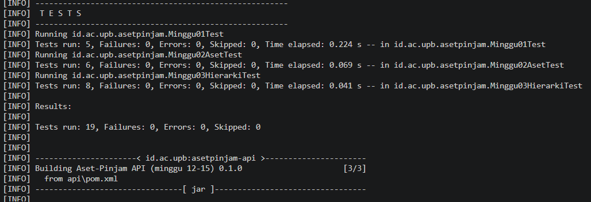
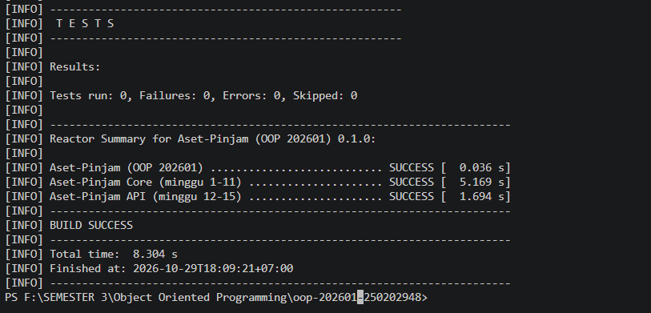

# Catatan Minggu 03: Inheritance

## Yang saya kerjakan

Pada minggu ketiga, tugas yang dikerjakan adalah menerapkan inheritance atau pewarisan pada Java. Ada tiga class yang dilengkapi, yaitu Ruang, Laptop, dan AlatLab. Ketiganya merupakan turunan dari class Aset.

Setiap class memiliki data tambahan yang berbeda. Ruang memiliki kapasitas, Laptop memiliki spesifikasi dan nomor inventaris, sedangkan AlatLab memiliki nama laboratorium dan tingkat risiko. Konstruktor, getter, dan method getJenis() juga dilengkapi sesuai kebutuhan setiap class.

Setelah kode selesai, pengujian dijalankan dari minggu pertama sampai minggu ketiga. Hasilnya, 19 tes berhasil dijalankan tanpa kegagalan maupun error, dengan status BUILD SUCCESS.

## Keputusan desain

Data umum seperti kode dan nama tetap disimpan di class Aset, sedangkan data khusus diletakkan pada class turunannya masing-masing. Hal ini dilakukan karena setiap jenis aset memiliki kebutuhan data yang berbeda.

Penggunaan super(kode, nama) bertujuan untuk memanggil konstruktor dari class induk. Dengan begitu, validasi yang sudah ada pada class Aset tetap digunakan tanpa perlu ditulis ulang.

Validasi juga disesuaikan dengan jenis datanya. Kapasitas ruang harus lebih dari nol, data teks tidak boleh kosong, dan tingkat risiko tidak boleh bernilai null. Method getJenis() digunakan untuk membedakan jenis setiap aset.

Inheritance cocok digunakan ketika beberapa class memiliki kesamaan. Namun, jika suatu aset membutuhkan fitur tambahan yang bisa dipasang atau dilepas secara terpisah, komposisi dapat menjadi pilihan yang lebih sesuai.

## Kendala

Kendala pertama muncul ketika PowerShell menolak menjalankan skrip uji.ps1 karena pengaturan Execution Policy. Masalah tersebut diatasi dengan mengatur Execution Policy sementara menggunakan perintah Set-ExecutionPolicy -Scope Process -ExecutionPolicy Bypass.

Kendala lainnya adalah error pada bagian @Override. Setelah diperiksa, penyebabnya adalah nama method pada class turunan tidak sama dengan method di class Aset. Nama method kemudian diperbaiki menjadi getJenis(), lalu pengujian dijalankan kembali. Setelah perbaikan, semua tes berhasil.

## Penggunaan AI

- **Alat yang digunakan:** Claude.
- **Bagian yang dibantu:** Memahami materi inheritance, membuat class turunan, dan mencari penyebab error pada kode.
- **Prompt utama:** "Jelaskan tugas inheritance minggu ketiga dengan bahasa yang mudah dipahami. Kenapa muncul error saat menjalankan pengujian dan bagaimana cara memperbaikinya?"
- **Perbaikan yang dilakukan:** Menyesuaikan nama method menjadi getJenis() agar sesuai dengan method pada class Aset, kemudian menjalankan pengujian kembali.
- **Hal yang dipelajari:** Memahami fungsi inheritance, penggunaan super() pada konstruktor, dan cara menggunakan @Override dengan benar.

## Dokumentasi Pengujian

- Gambar ini menunjukkan hasil pengujian program yang mencakup minggu pertama hingga minggu ketiga. Total terdapat 19 tes yang dijalankan, dengan 0 kegagalan dan 0 error. Pengujian class Ruang, Laptop, dan AlatLab pada minggu ketiga juga berhasil.

- Gambar ini menunjukkan hasil akhir proses build proyek Aset-Pinjam. Semua modul, yaitu Aset-Pinjam, Aset-Pinjam Core, dan Aset-Pinjam API, berstatus SUCCESS. Proses build selesai dengan status BUILD SUCCESS.