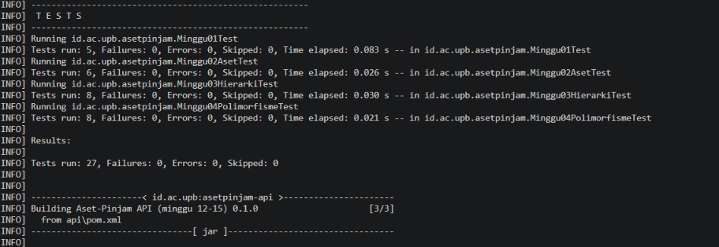
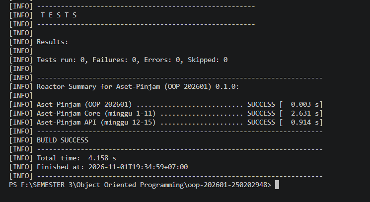

# Catatan Minggu 04: Polymorphism

## Yang saya kerjakan

Pada minggu keempat, saya mengerjakan materi Polymorphism dalam Java. Saya menambahkan method hitungDenda() pada kelas Aset dan melakukan overriding pada kelas Ruang, Laptop, dan AlatLab dengan pengali denda yang berbeda.

Saya juga membuat dua method cari()`pada kelas KatalogAset untuk mencari aset berdasarkan nama serta nama dan jenis aset.

## Keputusan desain

Saya menggunakan overriding agar setiap jenis aset memiliki perhitungan denda yang berbeda. Selain itu, saya menggunakan overloading pada method cari() dengan jumlah parameter yang berbeda. Pencarian nama juga dibuat tidak membedakan huruf besar dan kecil.

## Kendala

Saya sempat kesulitan memahami perbedaan overriding dan overloading serta menentukan pengali denda setiap jenis aset. Untuk mengatasinya, saya mempelajari kembali materi dan memeriksa hasil pengujian program.

## Penggunaan AI

Saya menggunakan bantuan AI untuk memahami materi dan mencari solusi ketika mengalami kesulitan.

Beberapa prompt yang digunakan:

1. Apa perbedaan overriding dan overloading dalam Java?
2. Bagaimana cara membuat perhitungan denda berbeda untuk setiap jenis aset?
3. Bagaimana cara membuat pencarian aset berdasarkan nama dan jenis aset?

Bantuan AI digunakan sebagai referensi untuk memahami materi dan menyelesaikan bagian program yang masih belum saya pahami. Selanjutnya, saya mempelajari dan menyesuaikan hasilnya dengan ketentuan tugas.

## Hasil Pengujian

Pengujian dilakukan menggunakan perintah:

    .\scripts\uji.ps1 -Minggu 4

Hasil pengujian menunjukkan 27 tes berhasil dengan 0 failures, 0 errors, dan 0 skipped. Proses build juga menunjukkan BUILD SUCCESS.

## Dokumentasi Pengujian

